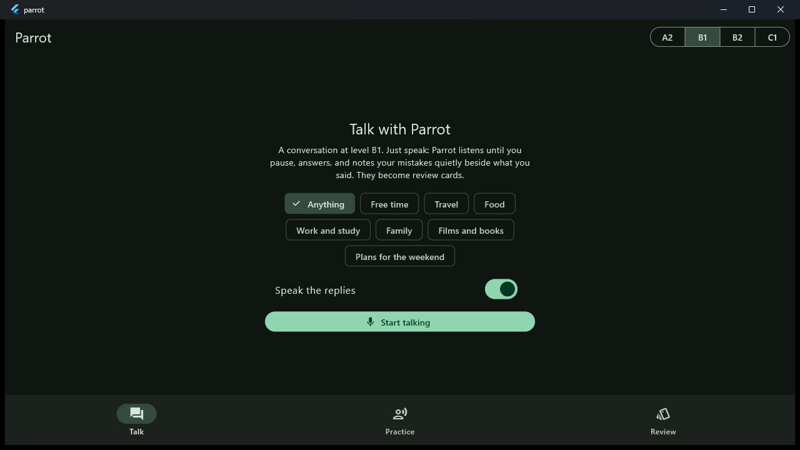
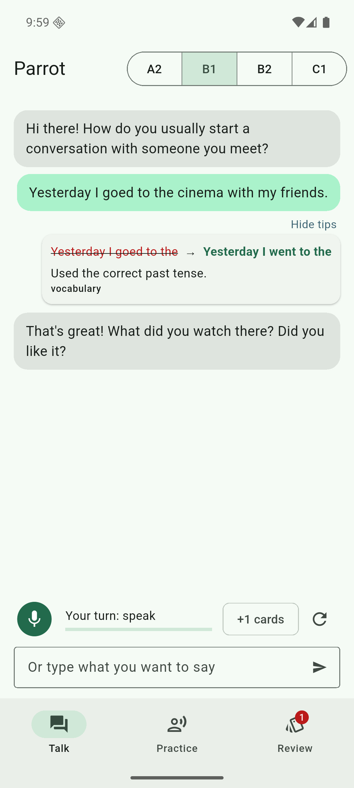
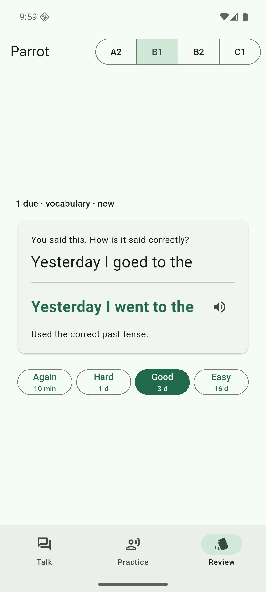

# Parrot

A conversation partner for learning English that runs entirely on your device: you speak, Whisper writes
down what you said, a local language model answers at your level (CEFR A2 to C1) and notes your mistakes
quietly beside your words. Your pronunciation is scored phoneme by phoneme, and every mistake becomes a
spaced-repetition card (FSRS). No account, no server, no API key.

| Windows | Android (emulator) | |
|---|---|---|
|  |  |  |

## What it does

- **Talk.** Hands-free: the microphone listens until you pause (voice activity detection), the speech is
  transcribed, and the partner answers, out loud if you like (Piper voice). Its reply never mentions
  your mistakes. They appear as a small "1 tip" under what you said: `I goed to → I went to`, with a
  one-line explanation. You can also type.
- **Practice.** Read a sentence aloud and get a score per word and per phoneme: green, amber or red,
  with the sound you were heard as ("θ as in think (sounded like s)"). "Hear it" plays the sentence.
- **Review.** Corrections and mispronounced words become cards. Making the same mistake again brings
  its card back today. Scheduling is FSRS-5 with its published default parameters; buttons show the next
  interval.

## How it works

```
microphone ─► VAD (C++, miniaudio) ─► Whisper (whisper.cpp) ─► text ─► tutor (llama.cpp, JSON grammar)
                                                                    │        └► reply ─► Piper voice (onnxruntime)
                                                                    └► corrections ─► cards (SQLite, FSRS in Dart)
read sentence ─► wav2vec2 phoneme posteriors (onnxruntime, int8) ─► CTC forced alignment over the expected
                 phonemes (CMUdict) ─► GOP features ─► scorer (ONNX) ─► phone / word / sentence scores
```

| Part | Language | Where |
|---|---|---|
| Engine: audio, VAD, recognition, alignment, voice, tutor | C++17 | [native/](native/) |
| Training and evaluation of the pronunciation scorer, engine evaluations | Python (PyTorch) | [ml/](ml/) |
| App for Windows and Android | Dart (Flutter) | [app/](app/) |
| Cards and their review history | SQL (SQLite) | [app/lib/srs/store.dart](app/lib/srs/store.dart) |

Some details:

- **Pronunciation model.** [facebook/wav2vec2-lv-60-espeak-cv-ft](https://huggingface.co/facebook/wav2vec2-lv-60-espeak-cv-ft)
  gives IPA phoneme posteriors at 50 frames per second. Its 392 tokens are folded into the 39 ARPAbet
  phonemes of CMUdict, plus blank and "other". Exported to ONNX with the normalization and log-softmax
  inside the graph: fp32 (1.26 GB, desktop) and int8 (357 MB, phones).
- **Alignment and features** (C++, [align.cpp](native/src/align.cpp)). Viterbi CTC alignment over the
  phonemes the sentence should have. For each phoneme it computes GOP over non-blank frames, the log
  posterior ratio to the best competitor, the share of frames it wins, its duration, and its full
  41-class posterior.
- **Scorer** ([train.py](ml/parrot_ml/train.py)). A small network per phoneme (with phoneme embedding and
  position), pooled per word and per sentence. It is trained on speechocean762 (2,500 utterances, 125
  non-native speakers, human scores per phoneme 0–2, word and sentence 0–10). The model is chosen on 10%
  of the training speakers, never on the test set.
- **Tutor** ([tutor.cpp](native/src/tutor.cpp)). The reply and three fixed correction slots are
  generated under a JSON-schema grammar; three slots rather than an array, because small models loop on
  arrays. Every correction is checked before it reaches you:
  - it must quote words you actually said;
  - it must change more than case or punctuation;
  - it must not just quote part of your sentence.
  A correction of a whole sentence is split by a word diff into one correction per change, each with up
  to two words of context.
- **Voice** ([tts.cpp](native/src/tts.cpp)). The Piper LJSpeech voice, phonemized without espeak (GPL):
  CMUdict ARPAbet is mapped to espeak-style IPA with stress marks. For words where CMUdict lists the
  cot–caught merged form first, the voice uses the AO form ("bought" was heard as "Bart" before).
  Numbers are spelled out.

## Results

Every number below comes from a script in this repository (files in [ml/eval/](ml/eval/)). The test
data were never used for training or model choice.

### Pronunciation scoring (speechocean762 test, 2,500 utterances, 47,369 phonemes)

Pearson correlation with the human scores, mean ± std over 3 seeds:

| Model | Phoneme | Word | Sentence |
|---|---|---|---|
| GOP + LPR, linear regression | 0.433 | – | – |
| **Per-phoneme network (shipped)** | **0.607 ± 0.005** | **0.599 ± 0.006** | **0.753 ± 0.004** |
| Transformer over the utterance (GOPT-like, 3 layers) | 0.595 ± 0.005 | 0.583 ± 0.001 | 0.734 ± 0.001 |
| *GOPT, Gong et al. 2022 (published)* | *0.612* | *0.549* | *0.742* |

The transformer did not help here: the wav2vec2 posteriors already carry the context it would add.

**Train/serve skew.** The scorer is trained on PyTorch posteriors; the app uses the ONNX models. The
exported scorer (ONNX), on the same 500 test utterances, gives:

| Phoneme model | Phoneme | Word | Sentence |
|---|---|---|---|
| PyTorch | 0.597 | 0.589 | 0.744 |
| ONNX fp32 | 0.597 | 0.589 | 0.744 |
| ONNX int8, every operation (first try) | 0.556 | 0.528 | 0.720 |
| **ONNX int8, per-channel, matrix products only (shipped)** | **0.603** | **0.590** | **0.741** |

Plain dynamic int8 cost 0.04 phoneme PCC. Quantizing only the transformer's matrix products, per
channel, and keeping the convolutional front end in fp32 costs nothing, for 39 MB more.

### Speech recognition on learners' speech (speechocean762 test, 500 utterances)

| Whisper | WER | Time per utterance (RTX 2060) |
|---|---|---|
| base.en, q5_1 (phones) | 0.301 | 133 ms |
| small.en, q5_1 (desktop) | 0.240 | 196 ms |

The speakers are Mandarin-speaking learners, many of them children, reading sentences. That is why the
error rates are far above Whisper's on native speech.

### The voice

20 conversational sentences spoken by Piper and read back by Whisper small: **WER 0.024**. Synthesis
takes 0.04× real time. The remaining errors include "coffee" heard as "Corfi" and "live" as "lime".

### The tutor (Qwen2.5-3B-Instruct Q4_K_M on an RTX 2060)

There are 40 typical learner sentences with 42 mistakes, plus 20 correct sentences
([tutor_cases.json](ml/eval/tutor_cases.json), written for this evaluation; levels B1).

| | Qwen2.5-3B (shipped) | Qwen2.5-7B |
|---|---|---|
| Mistakes found (recall) | **0.79** | 0.62 |
| Corrections that are real mistakes (precision) | **0.94** | 0.83 |
| Found mistakes fixed the expected way | 0.91 | 0.93 |
| Correct sentences "corrected" anyway | **0.10** | 0.15 |
| Latency, median / p90 | **3.0 s / 4.0 s** | 6.4 s / 8.4 s |

The checks matter. Before the "only quotes part of it" and empty-fix checks, and before splitting by word
diff, the 3B model "corrected" 30% of the correct sentences and fixed 76% of found mistakes as expected.

**Level.** Sentence length and Flesch-Kincaid grade of 10 replies per level:

| | A2 | B1 | B2 | C1 |
|---|---|---|---|---|
| Words per sentence | 6.2 | 6.1 | 6.8 | 8.4 |
| Flesch-Kincaid grade | 1.0 | 2.3 | 2.4 | 4.0 |

The replies get harder with the level, but less than the prompt asks for. A 3B model writes short,
simple conversational turns at every level, and B1 and B2 barely differ. This is the weakest part.

### Speed on devices

- **Windows desktop (RTX 2060, CUDA build):** a tutor turn takes about 3 s; recognizing an utterance
  takes about 0.2 s.
- **Android emulator (x86_64, 4 virtual cores, no GPU):** the whole flow works (microphone permission,
  listening, typed turn, correction, card, review, voice playback). The tutor's first turn took several
  minutes there, with the model loading on first use, and later turns too. The tutor is not usable at
  that speed. A phone with an arm64 CPU (dotprod) is much faster than this emulation, but I have not
  measured one.

## Tests

| What | Where | How many |
|---|---|---|
| Phonemes, folding, alignment (also with a wrong expectation), dictionary | [native/tests/native_tests.cpp](native/tests/native_tests.cpp) | 19 |
| VAD on synthetic audio, numbers and IPA, tutor checks and correction splitting, voice → Whisper round trip, scoring | [native/tests/engine_tests.cpp](native/tests/engine_tests.cpp) | 25 |
| Alignment through the C library, scorer, ONNX export at any length, WER, readability | [ml/tests/test_ml.py](ml/tests/test_ml.py) | 10 |
| FSRS, the card store in SQLite, mistakes → cards, engine JSON | [app/test/srs_test.dart](app/test/srs_test.dart) | 13 |
| The Windows app with the real models: typed conversation → correction → card → review | [app/integration_test/app_test.dart](app/integration_test/app_test.dart) | 1 |

CI ([.github/workflows/ci.yml](.github/workflows/ci.yml)) runs:
- the native build and tests on Linux and Windows (with the Whisper base model and the voice);
- the Python tests;
- `flutter analyze` and `flutter test`;
- the Windows app build;
- the Android APK build.

The evaluations, the integration test and the emulator run need the large models and the data, so they
run locally.

## Building

Requirements:
- CMake ≥ 3.22 and Visual Studio 2022 (Windows) or GCC/Clang (Linux);
- Flutter 3.47;
- for Android: SDK with NDK 29.0.14206865, CMake 3.31.6, JDK 21;
- for training: Python 3.14.

```bash
bash scripts/fetch-deps.sh                    # sources, onnxruntime, Whisper, voice, CMUdict (checked by SHA-256)
cmake -S native -B native/build -DPARROT_ENGINE=ON
cmake --build native/build --config Release
ctest --test-dir native/build -C Release
```

With an NVIDIA GPU (CUDA 13), build the faster engine. The app prefers it when it is there. On Windows,
use Ninja from a "x64 Native Tools" prompt; the Visual Studio generator mangles nvcc's arguments:

```bash
cmake -S native -B native/build-cuda -G Ninja -DCMAKE_BUILD_TYPE=Release -DPARROT_CUDA=ON -DCMAKE_CUDA_ARCHITECTURES=75 -DGGML_CUDA_FA_QUANTS=f16-f16
cmake --build native/build-cuda
```

**The phoneme and scorer models** are made by the Python side. The phoneme model comes from Hugging
Face, and the scorer is trained on speechocean762:

```bash
cd ml
python -m venv .venv && .venv/Scripts/pip install -r requirements.txt --index-url https://download.pytorch.org/whl/cu128 --extra-index-url https://pypi.org/simple
.venv/Scripts/python -m parrot_ml.export        # acoustic.onnx, acoustic-int8.onnx, acoustic.vocab.json
.venv/Scripts/python -m parrot_ml.features      # features of train and test (GPU, ~6 min)
.venv/Scripts/python -m parrot_ml.train         # baselines, 3 seeds each, scorer.onnx
```

`ml/data/` must hold `speechocean762-{train,test}.parquet` from
[mispeech/speechocean762](https://huggingface.co/datasets/mispeech/speechocean762).

**The language model** is any instruction-tuned GGUF model; Qwen2.5-3B-Instruct Q4_K_M was used here. Put
it in the models folder.

**The app:**

```bash
cd app
flutter run -d windows                         # models from PARROT_MODELS, <program>/models or %APPDATA%\Parrot\models
flutter build apk --target-platform android-arm64,android-x64
```

On Android, open the app once (it creates its models folder), then copy the models into it:

```bash
adb push native/third_party/models/. /sdcard/Android/data/dev.yustulinu.parrot/files/models/
```

On Windows, clone into a short path (for example `C:\src\Parrot`): llama.cpp's and whisper.cpp's build
trees exceed the 260-character path limit in deep folders.

## Licenses

The code is MIT ([LICENSE](LICENSE)). The models and data it uses come under their own licenses:

| Component | License |
|---|---|
| wav2vec2-lv-60-espeak-cv-ft | Apache-2.0 |
| Whisper | MIT |
| Piper and the LJSpeech voice | MIT and public domain |
| CMUdict | BSD-style |
| speechocean762 | CC BY 4.0 |
| whisper.cpp, llama.cpp, miniaudio | MIT / public domain |
| onnxruntime | MIT |
| Qwen2.5-3B-Instruct | Qwen Research License (not for commercial use; use another GGUF model if that matters) |
